# Database Design

PostgreSQL 16 with **PostGIS 3.4** (geography points, GiST indexes), **pgvector 0.6+** (`vector(384)`, HNSW cosine) and
**pg_trgm** (trigram search on folded text). The schema is defined in SQLAlchemy models and created **only** through Alembic
migrations (`backend/migrations/versions/0001…0004`). CI applies migrations up, down and up again, then runs `alembic check` to prove
the models and migrations have not drifted.

## Migrations

| Revision | Contents |
|---|---|
| 0001 | extensions; identity, roles/permissions, sessions, tokens, OIDC state; audit log + append-only trigger; settings, jobs, notifications |
| 0002 | categories, destinations (+GiST, trigram), translations, revisions, aliases, advisories, events, route segments, media |
| 0003 | knowledge documents/chunks (HNSW, GIN tsvector, trigram), knowledge graph, AI registry, conversations, feedback, eval runs, itineraries |
| 0004 | community, providers, awards, analytics |

## Entity relationships (core)

```mermaid
erDiagram
  users ||--o{ user_roles : has
  roles ||--o{ user_roles : grants
  roles ||--o{ role_permissions : includes
  permissions ||--o{ role_permissions : ""
  users ||--o{ user_sessions : opens
  users ||--o{ one_time_tokens : receives

  categories ||--o{ destinations : classifies
  destinations ||--o{ destination_translations : "en/ti/am"
  destinations ||--o{ destination_revisions : "published versions"
  destinations ||--o{ place_aliases : "Aksum/Axum/አክሱም"
  destinations ||--o{ destination_media : shows
  media_assets ||--o{ destination_media : ""
  destinations ||--o{ events : hosts
  destinations ||--o{ route_segments : "verified legs"

  knowledge_documents ||--o{ knowledge_chunks : "chunked + embedded"
  knowledge_documents ||--o{ kg_relations : "sources claims"
  kg_entities ||--o{ kg_relations : subject

  tie_conversations ||--o{ tie_messages : contains
  tie_messages ||--o{ tie_feedback : rated

  users ||--o{ itineraries : owns
  itineraries ||--o{ itinerary_versions : versions

  users ||--o{ memories : writes
  memories ||--o{ memory_media : ""
  media_assets ||--o{ memory_media : ""
  memories ||--o{ memory_comments : ""
  users ||--o{ consent_records : grants

  providers ||--o{ provider_members : "managed by"
  providers ||--o{ provider_verification_requests : ""
  providers ||--o{ provider_inquiries : receives

  competitions ||--o{ competition_categories : "with rubric"
  competitions ||--o{ competition_entries : receives
  competitions ||--o{ competition_judges : ""
  competition_entries ||--o{ competition_scores : ""
  competitions ||--o{ competition_winner_proposals : ""
```

## Design decisions

* **UUID primary keys** everywhere, except `audit_events.seq` (an identity column that orders the hash chain).
* **Timestamps** are `timestamptz`, stored in UTC. Ethiopian dates are computed, not stored, except for recurring festivals
  (`events.ethiopian_month/day`).
* **JSONB** holds localized short texts (`*_i18n`), published snapshots and flexible metadata. Long localized content uses rows
  (`destination_translations`), which lets each locale carry a review status.
* **Unknown is null.** Operational facts such as `visit_duration_minutes`, `permit_required='unknown'` and `accessibility.step_free='unknown'`
  are never defaulted to a guess.
* **Denormalized permission columns** on `knowledge_chunks` (`access_classification`, `destination_ids`, `published`) let
  retrieval filter in SQL before ranking.
* **Generated column** `knowledge_chunks.tsv = to_tsvector('simple', folded)`. The `simple` configuration is used because PostgreSQL ships
  no Tigrinya or Amharic stemmers. Folding (`app/core/ethiopic.py`) handles homophone letters, and transliteration bridges scripts.
* **Embedding dimension** is fixed at 384. Changing the embedding model to a different dimension requires a migration plus
  `POST /api/bureau/knowledge/reindex`.

## Indexes worth knowing

| Index | Purpose |
|---|---|
| `ix_destinations_search_trgm` (GIN trgm) | Cross-lingual destination search |
| `ix_destinations_location`, `ix_destinations_published_location` (GiST) | Geographic queries / `ST_DWithin` retrieval filter |
| `ix_knowledge_chunks_embedding` (HNSW, cosine, m=16, ef_construction=64) | Vector retrieval |
| `ix_knowledge_chunks_tsv` (GIN) + `ix_knowledge_chunks_folded_trgm` | Lexical retrieval |
| `ix_jobs_status`, `ix_jobs_run_after` | Worker polling with `SKIP LOCKED` |

## Integrity & privilege

* `audit_events` has a `BEFORE UPDATE OR DELETE` trigger that raises an error. In production the runtime role `vt_app` also has
  `UPDATE/DELETE/TRUNCATE` revoked (`infra/postgres/post-migrate-grants.sql`). Both protections were rehearsed: see `docs/TEST_REPORT.md`.
* `vt_migrator` owns the schema and runs migrations. `vt_app` has DML only and cannot alter or create tables (rehearsed).
* Foreign keys use `ON DELETE CASCADE` for owned data (memories → media links, itineraries → versions) and `SET NULL` where history
  should survive (memories → destination).

## Data retention (implemented)

| Data | Retention |
|---|---|
| Guide conversations | 30 days (`expires_at`; purged by worker) |
| Sessions | until expiry (8h staff / 12h visitors), then purged |
| OIDC login states | 1 hour |
| Notification one-time links | scrubbed from the outbox after delivery |
| Analytics events | day-granular, anonymous. **Retention period to be set by the Bureau** (unresolved) |
| Audit log | indefinite (append-only). Legal retention period to be confirmed (unresolved) |
