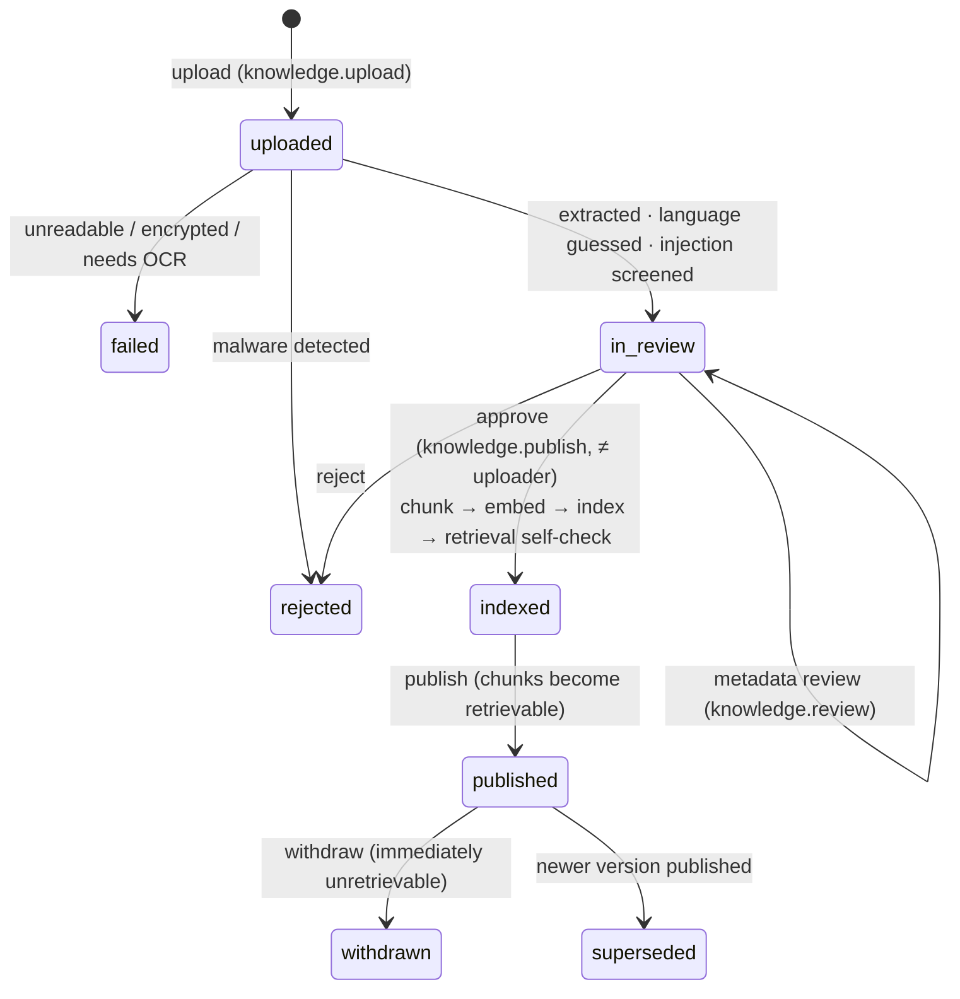

# Knowledge Governance — Tigray Knowledge Vault

## 1. Principles

1. **Nothing reaches visitors without human approval.** Every document passes review and four-eyes approval before indexing,
   and is invisible to retrieval until it is published.
2. **Provenance is mandatory.** Each record carries the title, author, publisher/institution, publication date, original language,
   rights status and licence note, URL or citation, geographic relevance, verification status, reviewer and review date,
   access classification, version and supersession, and a revalidation date.
3. **Custodians decide about sacred and restricted material.** `restricted` and `sacred` documents need a custodian approval
   reference to be approved, and are retrievable only by holders of `knowledge.read_restricted`.
4. **Disagreement is shown, not resolved.** Documents can be marked `disputed`. The guide is instructed to attribute each view,
   and the knowledge graph stores contested claims side by side, each with its source.
5. **Oral histories need informed consent.** `consent_reference` records the consent artefact. Withdrawal means withdrawing the
   document.

## 2. Workflow (implemented)

Approval is refused when:

* the approver uploaded the document (four-eyes);
* metadata has not been reviewed;
* a **public** document has `unknown` or `restricted` rights;
* a restricted or sacred document has no custodian approval reference;
* a public document has injection flags and no reviewer note containing "injection acknowledged".

Every transition is appended to `status_history` and to the audit log.

## 3. Access classifications

| Class | Who can retrieve | Typical content |
|---|---|---|
| `public` | everyone (including the public guide) | published heritage summaries, etiquette, festivals |
| `internal` | `knowledge.read_internal` | draft research, operational notes |
| `restricted` | `knowledge.read_restricted` | conservation details, sensitive archaeology |
| `sacred` | `knowledge.read_restricted` (+ custodian ref) | material about sacred objects and spaces |

The filter is part of the SQL query (`retrieval.clearance_for`). It is tested with a canary document (`VAULT-CANARY-7731`), which
must never appear for public callers or for staff without the restricted permission.

## 4. Rights statuses

`public_domain`, `cc_by`, `cc_by_sa`, `open_government`, `licensed`, `bureau_owned`, `permission_granted`, `restricted`, `unknown`.
Licensed third-party text (e.g. UNESCO summaries under CC BY-SA 3.0 IGO) must keep attribution in `license_note` and `citation`.
The development seed only **summarizes** facts with attribution. It does not copy copyrighted text.

## 5. Revalidation

`revalidate_on` marks time-sensitive documents (advisory background, visitor logistics). Bureau dashboards should list documents past
their revalidation date. The query is available through the assistant ("outdated"). A dedicated knowledge-freshness report is
**planned**.

## 6. Index reconstruction

`POST /api/bureau/knowledge/reindex` (`ai.admin`) re-chunks and re-embeds every indexed or published document. Use it after a restore,
after changing the embedding model, or after changing chunking rules.

## 7. Development seed

`evals/corpus/*.md` contains nine development-seed documents, all `is_synthetic=true` and `verification_status=unverified`:
summaries of widely documented public facts (with sources), two machine-assisted Tigrinya/Amharic drafts, and one restricted canary
fixture. The seed bypasses four-eyes approval and **refuses to run outside development/test**. **None of it is Bureau-approved
content.**
