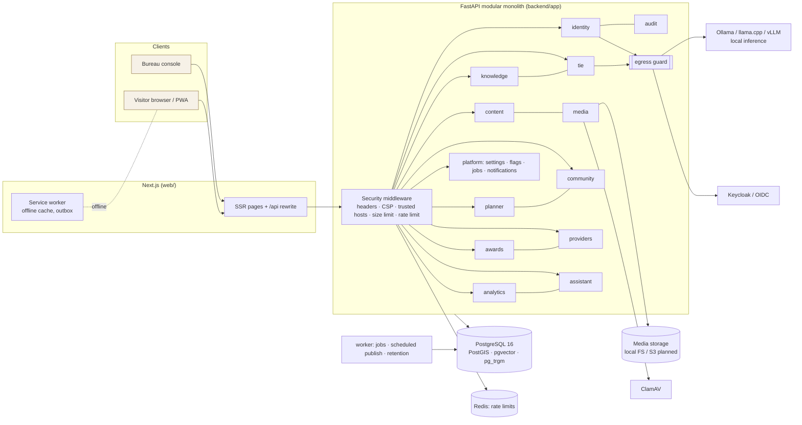

# System Architecture

Status: implemented in this branch unless marked **planned** or **unresolved**.

## 1. Shape: a modular monolith

One FastAPI process (plus a worker process) contains bounded-context modules with clear seams.
Modules talk through Python service functions inside one PostgreSQL transaction. That gives
transactional consistency without a distributed system. Any module can be extracted later
(TIE inference is the first candidate) because:

* each module owns its tables, `models.py`, `router.py` and service functions;
* cross-module calls go through a small number of service functions (e.g. `content.service.localize_snapshot`,
  `knowledge.retrieval.retrieve`, `planner.engine.build_plan`), not shared ORM mutation;
* outbound side effects (emails, reports) go through a **transactional outbox** (`jobs`/`notifications`).

Kubernetes and microservices are deliberately **not** introduced (ADR-0001).

## 2. Modules and responsibilities

| Module | Responsibility | Key tables | Authorization boundary |
|---|---|---|---|
| `identity` | Accounts (Argon2id), sessions, CSRF, TOTP MFA, email verification, password reset, OIDC (PKCE), roles & permissions | users, user_sessions, roles, permissions, role_permissions, user_roles, one_time_tokens, oidc_login_states | `require(perm)` + MFA for every staff permission |
| `audit` | Append-only, hash-chained audit log + verification | audit_events | `audit.view` |
| `platform` | Settings, feature flags, durable job queue, notification outbox, health, metrics | system_settings, jobs, notifications | `settings.manage` |
| `content` | Categories, destinations (working copy + published snapshot), translations, revisions, aliases, advisories, events, route segments | categories, destinations, destination_translations, destination_revisions, place_aliases, advisories, events, route_segments | public reads only from snapshots; `destinations.*`, `translations.*`, `geo.manage`, `advisories.manage`, `events.manage` |
| `media` | Upload validation, re-encoding, EXIF/GPS stripping, scanning, rights, signed URLs, dHash | media_assets, destination_media | owner / `media.manage` / `community.moderate` |
| `knowledge` | Knowledge Vault workflow, chunks + embeddings, hybrid retrieval, knowledge graph | knowledge_documents, knowledge_chunks, kg_entities, kg_relations | `knowledge.*`; classification filter in SQL |
| `tie` | AI orchestration: providers, modes, policy, context, tools, guide, conversations, registry, evaluation | ai_models, tie_conversations, tie_messages, tie_feedback, tie_eval_runs | public guide; `ai.admin` |
| `planner` | Deterministic itineraries, saved versions, share links, ICS/PDF | itineraries, itinerary_versions | object-level ownership |
| `community` | Tigray Memories, profiles, comments, follows, saves, blocks, reports, appeals, consent, export/delete | memories, memory_media, memory_comments, follows, saved_memories, user_blocks, content_reports, appeals, consent_records, creator_profiles | verified accounts; `community.moderate` |
| `providers` | Directory, verification, inquiries, booking model (flag-gated) | providers, provider_members, provider_verification_requests, provider_inquiries, booking_requests | membership; `providers.verify` |
| `awards` | Competitions, gates, rubrics, entries, judging, COI, winners, fulfilment, certificates | competitions, competition_* | `awards.manage/authorize/judge/approve_winners/finance` |
| `analytics` | Consent-gated engagement events, measured tourism, summaries, exports | analytics_events, tourism_measurements | `analytics.view`, `reports.export`, `tourism_stats.record` |
| `assistant` | Bureau AI assistant (read-only, permission-scoped) | — | `bureau.assistant` + per-intent permission |
| `social` | **Journals** (Substack-like publications, block-based long-form posts, likes, threaded comments, subscriptions with email digests), **Spaces** (Discord-like spaces/channels, membership, roles, slow mode, replies, reactions, SSE live stream), in-app notifications | publications, journal_posts, journal_likes, journal_comments, publication_subscriptions, spaces, space_channels, space_members, space_messages, space_message_reactions | verified accounts + membership; space moderators; `community.moderate` |

The editorial calendar, task assignments and integration management are **planned**. `editorial.assign` exists in the permission
catalogue, but the task tables are not built yet (see `docs/ROADMAP.md`).

## 3. Request lifecycle

1. `TrustedHostMiddleware` rejects unknown `Host` headers.
2. `SecurityHeadersMiddleware` assigns `X-Request-ID`, times the request (Prometheus histogram), and adds CSP, nosniff, frame and
   referrer policies, HSTS (outside development) and cache rules (`no-store` on auth/me/bureau).
3. `BodySizeLimitMiddleware` rejects oversized bodies before parsing.
4. Route dependencies: `rate_limit(bucket)`; `optional_principal` resolves the session from the cookie or a bearer token and enforces
   CSRF for cookie-authenticated unsafe methods; `require(...)` checks permissions and MFA.
5. Service code performs object-level checks (owner, membership, conflict of interest, four-eyes rules).
6. State changes call `audit.record(...)` in the same transaction, then commit.
7. Errors are rendered as `{"error": {"code", "message", "details"}}`.

## 4. Critical designs

### 4.1 Published snapshots (CMS)
Destinations have an editable working copy and an immutable `published_snapshot`. The public API serves only snapshots, so
drafts cannot leak. Publishing writes a numbered revision containing both the public snapshot and the working copy. Rollback
restores a revision's working copy and republishes it. Scheduled publication sets `status=scheduled` and the worker publishes
when `publish_at` passes. Archiving removes the snapshot immediately (emergency takedown).

### 4.2 Sensitive coordinates
`location_sensitivity` ∈ {public, coarse, hidden}. Snapshots contain coordinates rounded to 0.1° (≈11 km) for `coarse` and none for
`hidden`. Precise coordinates are returned only to holders of `heritage.read_restricted` and are never written to audit records.

### 4.3 Tigray Intelligence Engine
See `docs/LOCAL_AI_ARCHITECTURE.md`. Summary: screening → permission-filtered hybrid retrieval → optional generation through an
allow-listed tool gateway → output validation → extractive fallback. Every outbound call passes the **egress guard**
(`app/core/egress.py`), which enforces the administrator's AI mode before a socket is opened.

### 4.4 Deterministic planner
`app/modules/planner/engine.py`. It uses only published destinations. Advisories gate routing: a region-wide `travel_not_advised`
switches to virtual mode, and destination-level advisories exclude stops. An accessibility requirement excludes stops whose step-free
access is unknown, and says why. Verified road segments supply distance and time with their source. Otherwise the plan shows a
straight-line distance labelled as such, and the travel time is *unknown*. Costs and weather are not estimated. Manual edits are
re-validated and re-annotated server-side.

### 4.5 Social platform (Journals & Spaces)
Journal posts are **pre-moderated**: nothing is published automatically. They are stored as structured blocks
(paragraph/heading/quote/image/divider), never HTML. Subscribers get in-app notifications, plus email if they opted in (consent
recorded), exactly once per post. Space messages are **post-moderated** so conversation can happen in real time. Messages with
risky signals are *held* (visible only to the author and moderators). Membership, verified email, slow mode, time-limited
restrictions, block lists and rate limits apply. Live delivery uses Server-Sent Events (ADR-0008).

### 4.6 Guide & planner hand-off
The guide returns deterministic **action chips**: `open_planner` with parsed days and interests, and `open_destination` from
cited evidence. Every plan carries a **summary**, a **pre-travel checklist** (permits, advisories, unknown accessibility, stale
verification, unknown durations, unverified legs) and per-stop **alternatives**. `POST /api/planner/annotate` re-validates
drag-and-drop edits server-side, so clients can never assert distances, durations or blocked stops.

### 4.7 Governance rules enforced in code
* **Four-eyes:** translation approval, knowledge approval, competition gates, winner approval and appeals each need a different person.
* **Conflict of interest:** moderators can't moderate their own content; verifiers can't verify providers they belong to; judges declare
  conflicts and can't score conflicted entries; staff and judges can't enter competitions.
* **Feature flags:** bookings, payments, public voting and live competitions are off by default. Turning a guarded flag on requires an
  audited written justification.

## 5. API specification

The OpenAPI 3 document is exported to `docs/api/openapi.json` (159 paths at the time of writing) and served at
`/api/docs` when `EXPOSE_API_DOCS=true`. Conventions:

* JSON everywhere except uploads (multipart) and exports (CSV, XLSX, PDF, ICS).
* Locale via `?locale=en|ti|am`. Responses report `locale`, `requested_locale` and `translation_status`.
* Cursor pagination for feeds (`next_cursor`); `limit`/`offset` for directories.
* Idempotency: jobs use `idempotency_key`; the booking model requires one.

## 6. Background processing

`python -m app.worker` claims due jobs with `FOR UPDATE SKIP LOCKED` (safe with several workers). It retries with exponential
backoff, marks jobs `dead` after `max_attempts`, and every minute runs housekeeping: scheduled publication, expired conversations,
sessions and OIDC states.

## 7. Observability

* `/metrics` (Prometheus): `vt_http_request_seconds{method,route,status}`, `vt_ai_inference_seconds{provider,mode,outcome}`,
  `vt_tie_answers_total{mode,confidence,path}`, `vt_rate_limited_total{bucket}`.
* Structured JSON logs (`app/core/logging.py`) that never include secrets, story bodies or conversation text.
* Grafana dashboard provisioned from `infra/grafana/dashboards/visit-tigray.json`.
* OpenTelemetry tracing is **planned**: the request id is propagated, but no OTel exporter is installed yet (keeping dependencies minimal).
