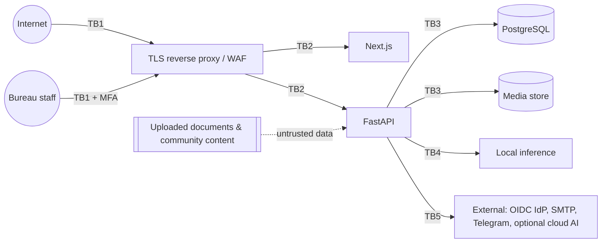

# Threat Model

Method: STRIDE per trust boundary, using OWASP ASVS 4.0.3 and the OWASP API Security Top 10 (2023) as references. This is an
engineering threat model written by the development team. It is **not** a substitute for an independent penetration test,
which is a release blocker.

## 1. Assets

1. Bureau-approved heritage knowledge, including restricted/sacred material and precise coordinates of protected sites.
2. Official travel advisories (integrity is safety-relevant).
3. Visitor personal data: accounts, stories, photos, itineraries, inquiries, guide conversations.
4. Staff identities and privileges; the audit log.
5. Competition integrity (entries, scores, winners, sponsor records).
6. Platform availability during connectivity crises.

## 2. Trust boundaries

* **TB1** Internet → edge: TLS, HSTS, rate limits, trusted hosts.
* **TB2** Edge → apps: only `/api/*` reaches FastAPI; the web tier holds no secrets.
* **TB3** App → data: least-privilege `vt_app` role (DML only; append-only audit), media served via the API with authorization.
* **TB4** App → model: the model is **untrusted**. Its output is validated, and it has no direct data or tool access beyond the
  read-only gateway.
* **TB5** App → external: every HTTP call goes through the egress guard (mode policy, https-only external calls, no link-local
  or metadata addresses).
* **Content boundary:** documents, stories, comments and filenames are untrusted data at every step.

## 3. Threats and controls

| ID | STRIDE | Threat | Controls (implemented) | Residual / open |
|---|---|---|---|---|
| T1 | S | Credential stuffing / brute force | Argon2id, lockout after 5 failures (15 min), auth rate limit, uniform error messages, timing equalization | No CAPTCHA/bot challenge yet (open) |
| T2 | S | Staff account takeover | TOTP MFA required for every staff permission; OIDC with `amr` MFA mapping; sessions revoked on password reset and role change | WebAuthn/passkeys planned |
| T3 | T | CSRF on cookie sessions | Per-session CSRF token required on unsafe methods; SameSite=Lax; bearer tokens exempt | — |
| T4 | E | Broken object-level authorization (API1) | Ownership/membership checks return 404 (no existence leak); tests for itineraries, stories, inquiries, certificates | Continued test coverage required for new routes |
| T5 | E | Broken function-level authorization (API5) | `require(perm)` dependencies; data-driven roles; self-modification of roles blocked | — |
| T6 | T | Audit tampering | DB trigger blocks UPDATE/DELETE; runtime role lacks the privileges; SHA-256 hash chain verifiable at `/api/bureau/audit/verify` | Off-site anchoring of the chain head (planned) |
| T7 | I | Leak of restricted heritage knowledge | SQL classification filter; canary tests; custodian reference required; coordinate coarsening | Human error in classification (mitigated by review) |
| T8 | I/T | Prompt injection, direct and indirect (LLM01) | See `docs/LOCAL_AI_ARCHITECTURE.md` §5 | Novel phrasings; evaluation set must grow |
| T9 | I | Data exfiltration to cloud AI | Egress guard + admin mode policy + audited justification; socket-level test | Misconfigured DNS names that resolve to public IPs (names are classified syntactically; only listed names count as local) |
| T10 | T | Malicious uploads (polyglots, decompression bombs, malware) | Magic bytes + decoder verification, pixel limit, re-encode to WebP, metadata stripped, ClamAV hook, quarantine, size limits | ClamAV required outside dev (enforced by config validation) |
| T11 | I | Location leakage via photo EXIF | GPS/EXIF stripped by re-encoding (tested) | — |
| T12 | S/T | SSRF | No user-supplied URL is fetched; source URLs are stored as metadata only; egress guard blocks link-local and metadata IPs | — |
| T13 | D | API abuse / resource exhaustion (API4) | Rate limits per bucket, body-size limit, field length limits, pagination caps, AI context and tool budgets, timeouts | In-memory limiter is per-process. Use Redis in production (supported) |
| T14 | T | Competition fraud | Integrity flags (dHash, text overlap), entry limits, staff ineligibility, COI, anonymous judging, four-eyes winners | Public voting is disabled until anti-fraud measures are approved |
| T15 | T | False advisories or content | `advisories.manage` + MFA, audit, instant withdraw/archive | Two-person rule for advisories (open: recommended) |
| T16 | R | Repudiation of staff actions | Audit records actor, action, resource, time, IP, request id, outcome, changes (secrets redacted) | — |
| T17 | I | XSS | React escaping; API CSP `default-src 'none'`; no HTML rendering of user content | Web CSP must be verified in deployment (see frontend docs) |
| T18 | I | Secrets in repository | `.gitignore`, `.env.example` placeholders, gitleaks in CI, production config validation | — |
| T19 | E | Vulnerable dependencies | pip-audit / npm audit in CI, SBOM, locked versions | Patch cadence needs an owner |
| T20 | D | Connectivity loss | PWA offline cache, retrieval-only AI, edge profile | Edge deployment not yet rehearsed |

## 4. Known gaps that block production

1. Independent penetration test and ASVS L2 verification.
2. Production TLS, WAF and DDoS posture (deployment-specific).
3. Malware scanner and S3 encrypted storage provisioned and tested.
4. Organizational incident-response roles and contacts (see `SECURITY.md`).
5. Legal review: privacy, competitions, heritage, tourism regulations.
